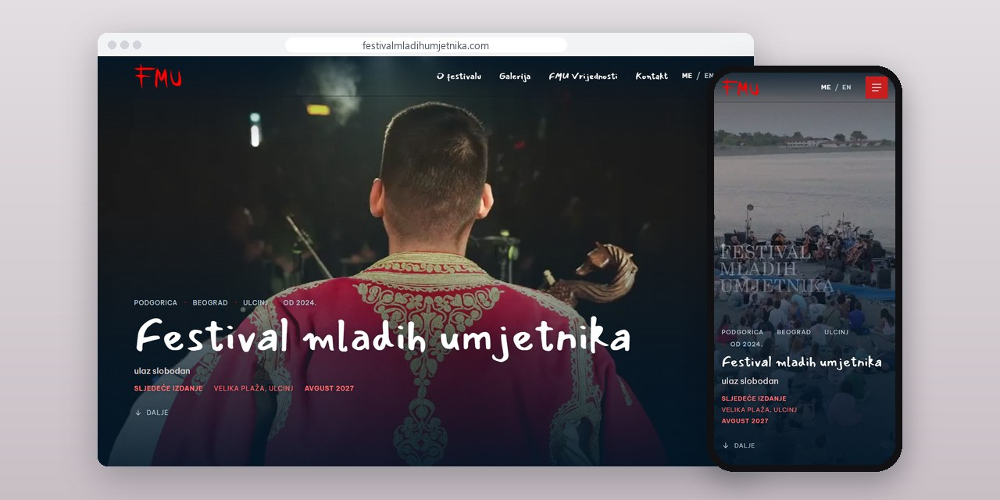
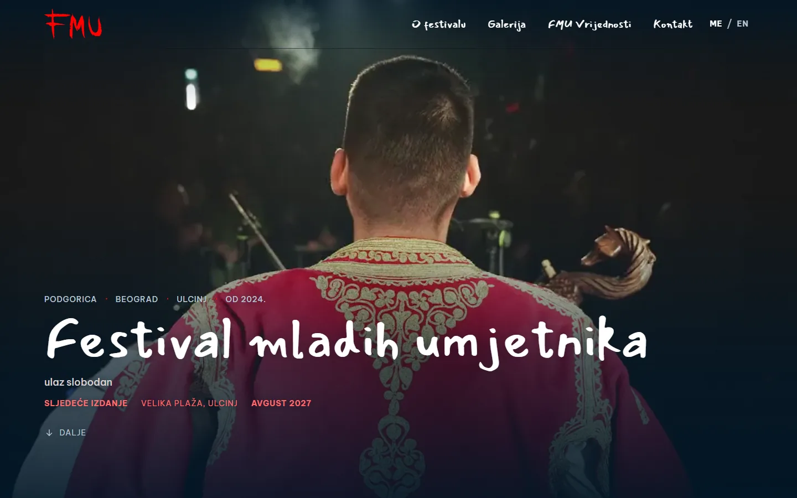
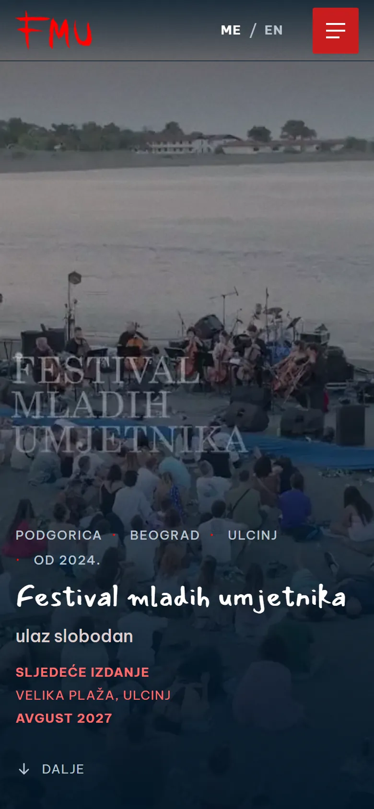
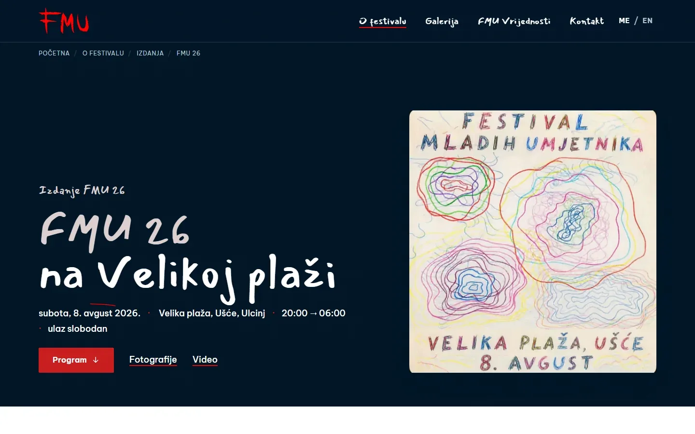
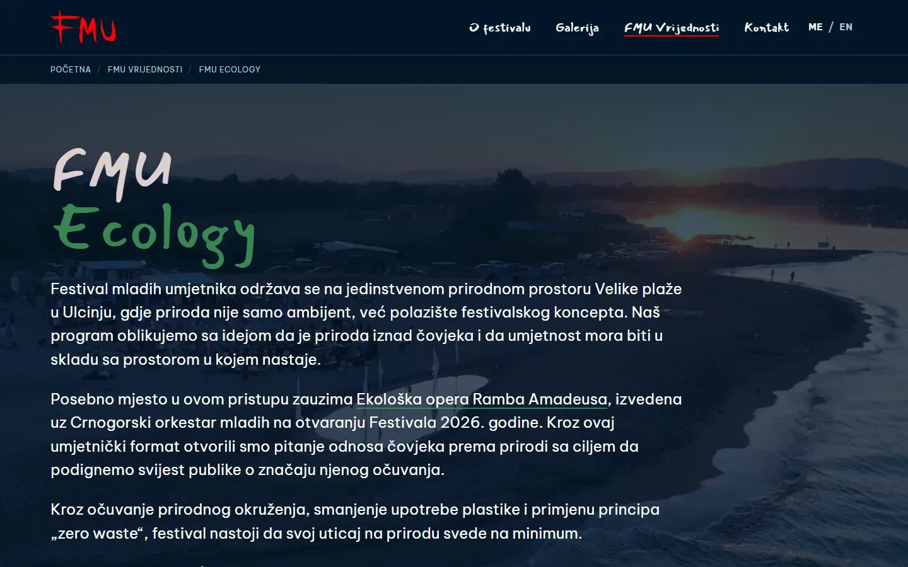

# Festival mladih umjetnika

A bilingual site for a festival that runs from sunset to sunrise, with an aftermovie on the home page and a page for each of its five editions.

**[festivalmladihumjetnika.com](https://festivalmladihumjetnika.com/)** · [Case study](https://svilenkovic.com/portfolio/festival-mladih-umjetnika) · [Srpski](README.sr.md)

> [!NOTE]
> Client project. The source code belongs to the client and stays in a private repository. This page describes what I built and how.

<table>
  <tr><td><b>Client</b></td><td>Festival mladih umjetnika (FMU)</td></tr>
  <tr><td><b>Industry</b></td><td>Music and contemporary art festival</td></tr>
  <tr><td><b>Location</b></td><td>Podgorica and Ulcinj, Montenegro</td></tr>
  <tr><td><b>Type</b></td><td>Bilingual festival website</td></tr>
  <tr><td><b>My role</b></td><td>Design, development, SEO and hosting</td></tr>
  <tr><td><b>Stack</b></td><td>Astro 7, TypeScript, HTML5 video, WebP, JSON-LD</td></tr>
</table>

## About the project

Festival mladih umjetnika (Young Artists Festival) runs from sunset to sunrise and ends with a classical concert at dawn. Since 2024 it has been held at the Military Hangar in Podgorica, at the Drugstore club in Belgrade and on Velika plaža in Ulcinj, and entry to the editions in Montenegro was free. The site had to carry the mood of that night and also keep every edition on record with its program, photos and partners.

The home page opens with the aftermovie across the whole screen, muted, with sound and pause buttons on desktop and on phones, which get a narrower upright cut. When the system asks for reduced motion or data saver is on, the video is not loaded and a photo stays in its place. Each of the five editions has its own page with the date, venue, hourly timetable, photos, video and partners, and I copied the timetables of the earlier editions from their posters.

## What I built

- 29 pages, 16 in Montenegrin and 13 in English under /en/
- Pages for five editions with timetables, and structured data that describes the festival as an event series with individual performances
- A gallery split by edition, with an enlarged view and photo source credits
- YouTube videos with a still frame and duration, loaded from youtube-nocookie.com only on click
- FMU Vrijednosti (FMU Values) with two pages, FMU Ecology and FMU Humanity, in the festival's own words
- A contact form with a topic for artists who want to perform or exhibit and a field for a link to their work

## Results

| | Performance | Accessibility | Best practices | SEO |
| :-- | :-: | :-: | :-: | :-: |
| Mobile | 100 | 100 | 100 | 100 |
| Desktop | 100 | 100 | 100 | 100 |

PageSpeed Insights, lab test of the live site, November 2026. Security headers: 6 of 6. axe accessibility check: no violations. Structured data: `EntertainmentBusiness`, `EventSeries`, `NGO`.

## Screenshots

<table>
  <tr>
    <td width="68%" valign="top"></td>
    <td width="32%" valign="top"></td>
  </tr>
</table>

FMU 26 on Velika plaža: date, venue, timetable from 20:00 to 06:00 and the poster of the edition

FMU Ecology: the festival's text about nature and zero waste, with a photo of Velika plaža

---

Built by [D. Svilenković](https://svilenkovic.com).
