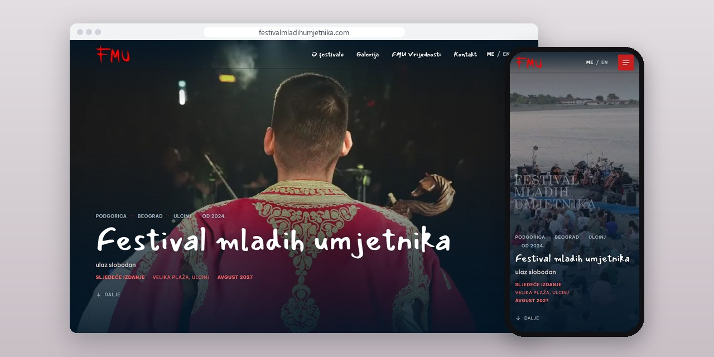
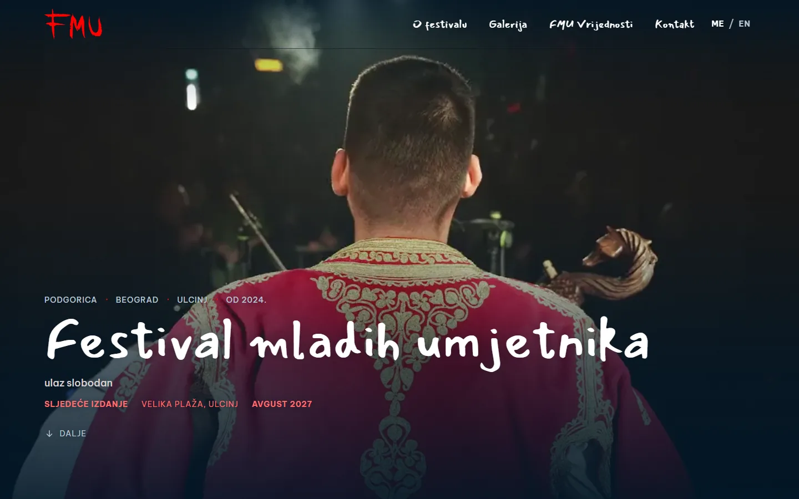
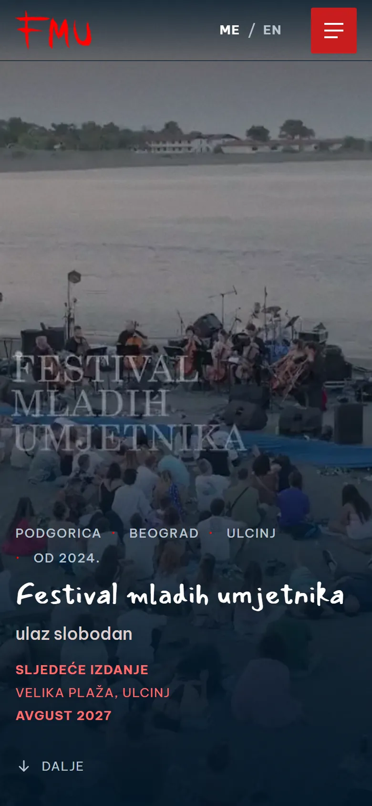
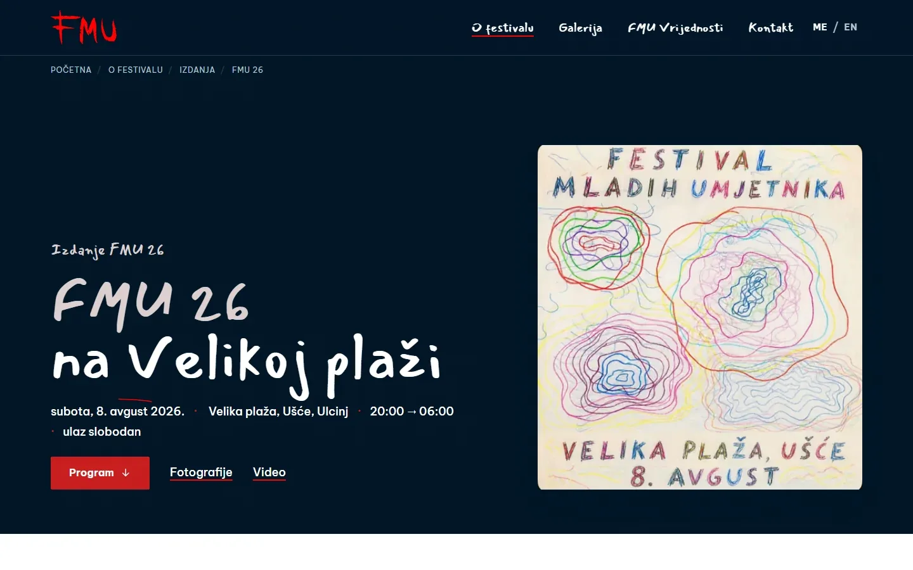
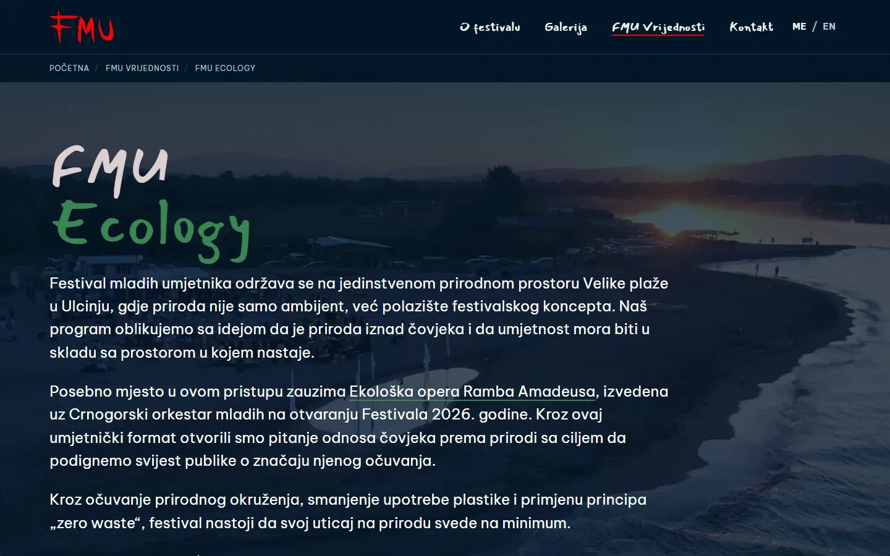

# Festival mladih umjetnika

Dvojezični sajt festivala koji traje od zalaska do izlaska sunca, sa aftermovie snimkom na naslovnoj i stranom za svako od pet izdanja.

**[festivalmladihumjetnika.com](https://festivalmladihumjetnika.com/)** · [Studija slučaja](https://svilenkovic.rs/radovi/festival-mladih-umjetnika) · [English](README.md)

> [!NOTE]
> Klijentski projekat. Izvorni kod pripada klijentu i čuva se u privatnom repozitorijumu. Ova stranica opisuje šta sam uradio i kako.

<table>
  <tr><td><b>Klijent</b></td><td>Festival mladih umjetnika (FMU)</td></tr>
  <tr><td><b>Delatnost</b></td><td>Festival muzike i savremene umetnosti</td></tr>
  <tr><td><b>Lokacija</b></td><td>Podgorica i Ulcinj, Crna Gora</td></tr>
  <tr><td><b>Vrsta</b></td><td>Dvojezični sajt festivala</td></tr>
  <tr><td><b>Moj deo posla</b></td><td>Dizajn, izrada, SEO i hosting</td></tr>
  <tr><td><b>Tehnologije</b></td><td>Astro 7, TypeScript, HTML5 video, WebP, JSON-LD</td></tr>
</table>

## O projektu

Festival mladih umjetnika traje od zalaska do izlaska sunca i završava se koncertom klasične muzike u svitanje. Od 2024. održan je u Vojnom hangaru u Podgorici, u beogradskom klubu Drugstore i na Velikoj plaži u Ulcinju, a ulaz na izdanja u Crnoj Gori bio je slobodan. Sajt je trebalo da prenese tu noć, ali i da svako izdanje ostane zapisano sa programom, fotografijama i partnerima.

Naslovna počinje aftermovie snimkom preko celog ekrana, bez zvuka, sa dugmadima za zvuk i pauzu na računaru i na telefonu, koji dobija uži, uspravan kadar. Kada sistem traži manje pokreta ili je uključena ušteda podataka, video se ne učitava i ostaje fotografija. Svako od pet izdanja ima svoju stranu sa datumom, mestom, satnicom po satima, fotografijama, videom i partnerima, a satnice ranijih izdanja prepisao sam sa plakata.

## Šta sam uradio

- 29 strana, 16 na crnogorskom i 13 na engleskom pod /en/
- Strane za pet izdanja sa satnicom i strukturisani podaci koji opisuju festival kao seriju događaja sa pojedinačnim nastupima
- Galerija podeljena po izdanjima, sa uvećanim pregledom i potpisom izvora fotografija
- YouTube snimci sa slikom kadra i trajanjem, koji se sa youtube-nocookie.com učitavaju tek na klik
- FMU Vrijednosti sa dve strane, FMU Ecology i FMU Humanity, sa tekstom onakvim kakav je festival napisao
- Kontakt forma sa temom za izvođače koji žele da nastupe ili izlažu i poljem za link do rada

## Merenja

| | Performanse | Pristupačnost | Dobre prakse | SEO |
| :-- | :-: | :-: | :-: | :-: |
| Telefon | 100 | 100 | 100 | 100 |
| Desktop | 100 | 100 | 100 | 100 |

PageSpeed Insights, laboratorijsko merenje živog sajta, novembar 2026. Sigurnosna zaglavlja: 6 od 6. axe provera pristupačnosti: bez prekršaja. Strukturisani podaci: `EntertainmentBusiness`, `EventSeries`, `NGO`.

## Snimci ekrana

<table>
  <tr>
    <td width="68%" valign="top"></td>
    <td width="32%" valign="top"></td>
  </tr>
</table>

FMU 26 na Velikoj plaži: datum, mesto, satnica od 20:00 do 06:00 i plakat izdanja

FMU Ecology: tekst festivala o prirodi i principu „zero waste”, sa fotografijom Velike plaže

---

Izrada: [D. Svilenković](https://svilenkovic.rs).
